<a href="https://ilg.az">
  <picture>
    <source media="(prefers-color-scheme: dark)" srcset="assets/header-dark.svg" />
    
  </picture>
</a>

  
  
  
  

<picture>
  <source media="(prefers-color-scheme: dark)" srcset="assets/h-about-dark.svg" />
  
</picture>

<picture>
  <source media="(prefers-color-scheme: dark)" srcset="assets/about-dark.svg" />
  
</picture>

  

<picture>
  <source media="(prefers-color-scheme: dark)" srcset="assets/h-stack-dark.svg" />
  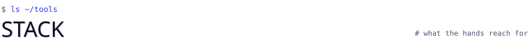
</picture>

<picture>
  <source media="(prefers-color-scheme: dark)" srcset="assets/stack-dark.svg" />
  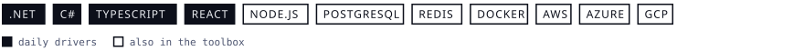
</picture>

  

<picture>
  <source media="(prefers-color-scheme: dark)" srcset="assets/h-projects-dark.svg" />
  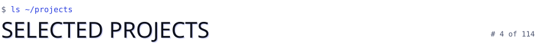
</picture>

  <a href="https://github.com/theilgaz/mahfuz"><picture><source media="(prefers-color-scheme: dark)" srcset="assets/p-mahfuz-dark.svg" />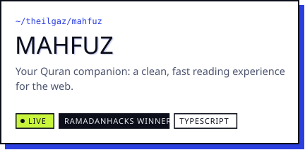</picture></a>
  <a href="https://github.com/theilgaz/fastql"><picture><source media="(prefers-color-scheme: dark)" srcset="assets/p-fastql-dark.svg" />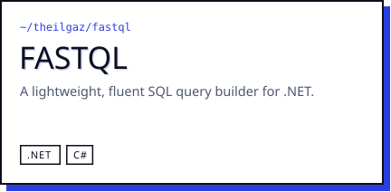</picture></a>
  <a href="https://github.com/theilgaz/winforms-dependency-injection"><picture><source media="(prefers-color-scheme: dark)" srcset="assets/p-winforms-dependency-injection-dark.svg" />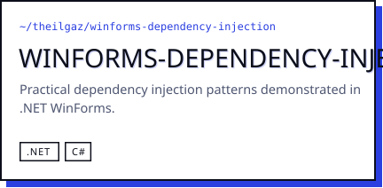</picture></a>
  <a href="https://github.com/theilgaz/FGX"><picture><source media="(prefers-color-scheme: dark)" srcset="assets/p-fgx-dark.svg" />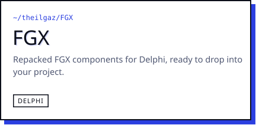</picture></a>

  <code>$ open</code> <a href="https://mahfuz.ilg.az">mahfuz.ilg.az</a>, winner at <a href="https://www.ramadanhacks.com/">RamadanHacks</a>

 

<picture>
  <source media="(prefers-color-scheme: dark)" srcset="assets/h-rank-dark.svg" />
  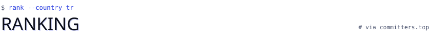
</picture>

<a href="https://committers.top/turkey#theilgaz">
  <picture>
    <source media="(prefers-color-scheme: dark)" srcset="assets/rank-dark.svg" />
    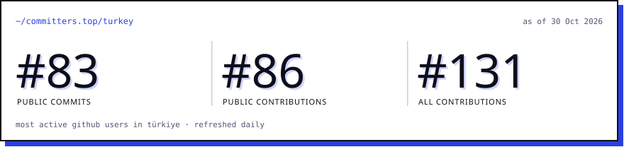
  </picture>
</a>
